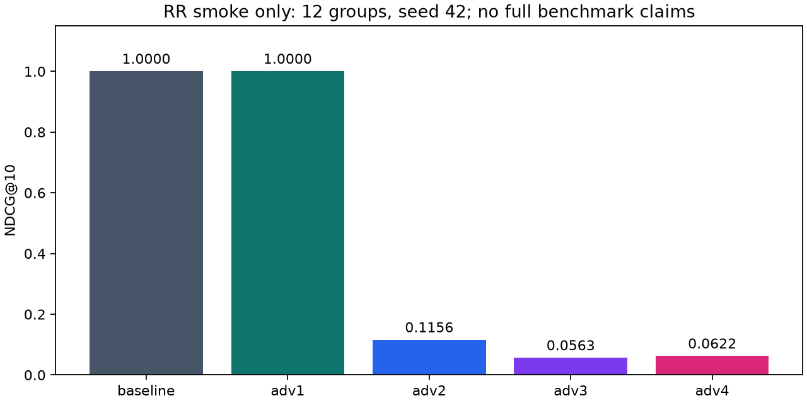

# Полученные результаты рабочего концепта

Дата фиксации: 2026-10-20. Статус проекта: **Рабочий концепт**.
Все большие фоновые задачи остановлены по решению заказчика. Итоги ниже взяты
из завершённых локальных артефактов; незавершённые попытки не считаются результатами.
Тяжёлые таблицы, веса и внутренние журналы сохранены локально и исключены из публикации.

## 1. Реальные smoke-прогоны моделей

Retailrocket, prefix20000 событий, valid11/test12 групп, training seed42.
Каждая test group содержит один ground truth и99 негативов. Все семь вариантов
оценены на одном замороженном candidate pool с SHA-256:

`8a4b3a25fc74426677e7e8f1fdc669dcedb95596a575588ec7f4366456d01f2f`

| Модель | NDCG@10 | Macro AUC | Sampled LogLoss | Run wall, s |
|---|---:|---:|---:|---:|
| Baseline GBDT | 1.000000 | 1.000000 | 0.00000736 | 6.52 |
| Adv1 AutoML | 1.000000 | 1.000000 | 0.00001739 | 5.92 |
| Adv2 GraphSAGE | 0.115571 | 0.600168 | 0.05600153 | 44.23 |
| Adv3 Sequential | 0.056326 | 0.365320 | 0.05908083 | 38.49 |
| Adv4 Fusion | 0.062178 | 0.530303 | 0.05602099 | 131.71 |
| Score-feature stacking | 1.000000 | 1.000000 | 0.00001265 | 66.10 |
| Soft-target distillation | 1.000000 | 1.000000 | 0.00000724 | 69.19 |

Run wall относится к конкретному локальному pipeline run; не является p50/p95
inference latency. У Fusion из131,71s около50,67s приходится на upstream GraphSAGE.
Ресурсы и кэши разных запусков не нормировались в отдельном performance benchmark.

На этом небольшом наборе нейросетевые варианты уступили Baseline; скрывать
такой результат оснований нет. При12 группах и одном seed нельзя переносить
ранжирование моделей на полные datasets или заявлять статистическое превосходство.
Для soft-target выбран alpha=1: teacher mixture на inner-train probe не улучшил
критерий. Вариант stacking сохраняет зависимость от teacher при inference.
LogLoss условен на sampled pool с prevalence1/100 и не является оценкой реального CTR.

Полный компактный экспорт всех15 метрик по семи cohorts и семи моделям: [smoke_metrics.json](results/smoke_metrics.json). В cold-start smoke train-cold users —11 групп, train-cold items —8, long-tail —3; event-cold и short-session пусты, их метрики null.

## 2. Проверки генератора на ограниченных данных

| Dataset | Режим | Events | Valid groups | Test groups |
|---|---|---:|---:|---:|
| Retailrocket | prefix20000 | 20000 | 11 | 12 |
| MovieLens | prefix20000 | 20000 | 17 | 16 |
| Taobao | целые истории users_mod4096 | 24489 | 42 | 41 |
| Yoochoose | целые sessions_mod4096 | 7982 | 201 | 174 |

Все эти generator smoke прошли gates. Замеренные wall для Taobao364,18s и
Yoochoose57,64s включают чтение исходников для validation/metadata и не
характеризуют обучение моделей на этих datasets.

## 3. Полностью подготовленные данные

| Показатель | Retailrocket | MovieLens20M |
|---|---:|---:|
| Events после нормализации | 2755641 | 20000263 |
| Реальные train anchors | 17864 | 7996796 |
| Training negatives | 71456 | 31987135 |
| Primary valid groups | 1333 | 17571 |
| Primary test groups | 1179 | 18337 |
| Fallback valid groups, отдельно | 3038 | 113 |
| Fallback test groups, отдельно | 2904 | 110 |
| Quality gates passed | 35/35 | 35/35 |
| Generator internal wall, s | 1788,56 | 4402,20 |
| Profiled process-tree wall, s | 1810,86 | 4438,99 |
| Profiled CPU, s | 1711,25 | 5435,14 |
| Sampled peak RSS, bytes | 2889388032 | 5459644416 |

Internal wall и process-tree wall — разные измерения. RSS — дискретный максимум
суммы RSS процессов, а не точный непрерывный peak. Полный Retailrocket устранил
460 точных дубликатов исходных событий. Fallback не смешивается с primary.

Полные Yoochoose/Taobao не завершены. Последняя Yoochoose attempt4 остановлена;
частичные negative rows не являются опубликованным готовым train artifact.

## 4. Технические улучшения, подтверждённые измерением

На одном хронологическом префиксе MovieLens из1000000 train events получено
1937451 negative rows. Все варианты дали побитно одинаковый Parquet SHA-256:

`8e581178069077f359eccd8f654df5b5566bf2357cc3db94c4ca40640b91ca05`

| Вариант | Process wall, s |
|---|---:|
| Legacy SQL negative-ID registry, USB scratch | 123,98 |
| Exact Parquet key gate, USB scratch | 90,41 |
| Exact Parquet key gate, NVMe system temp | 86,27 |

Повторная SQL-регистрация IDs исключена из generator path; обязательный точный
schema/unique gate сохранён до публикации train inputs. Один ordered probe
подтверждает идентичность этого префикса; он не доказывает ускорение полного
pipeline или улучшение рекомендаций. В NVMe probe sampled peak473628672 bytes.

Исправлен lifetime native spill: до исправления реальный collector дал750 native
panic messages из-за удалённого temp path, после исправления —0. Проверены
последовательные реальные OOC sorts и удаление process-owned каталога на exit.
Добавлены journal locking, сохранение неуспешных попыток и recovery после reboot.

## 5. Тестирование и границы готовности

Последний полный suite до подготовки публикации: **180 passed,2 внешних Torch
deprecation warnings,349,25s**, покрытие с учётом ветвей **95,86%**. Storage93%.
Проверены temporal ties, strict-prefix visibility, collision handling, seeds,
OOF lineage, общие candidate keys, метрики, калибровка и реальные backend fits.
Перед публикацией на отдельной чистой копии без datasets выполнены176 fixture
tests:176 passed,4 real-data cases deselected,2 внешних предупреждения,269,01s;
покрытие с учётом ветвей95,73%. Отдельно на локальных исходниках прошли4 real-data
tests за0,86s. Итого все180 проверок пройдены в двух режимах; покрытие этих
режимов не объединялось. [Машиночитаемый результат](results/verification.json).

| Полный эксперимент | Завершено |
|---|---:|
| Основная матрица4 datasets ×5 моделей ×3 seeds | 0/20 конфигураций |
| Дистилляция,2 режима ×4 datasets | 0/8 |
| Synthetic branches, включая primary controls | 0/80 |
| Objective/component variants, включая controls | 0/48 |

Полные bootstrap CI, Holm contrasts, superiority claims и экономия ручного
труда не установлены. Human minutes и p50/p95 latency не измерялись.
Успех концепта означает работоспособность реализации и технических прогонов;
полная программа [experiment_plan.md](experiment_plan.md) остаётся отдельной работой.
