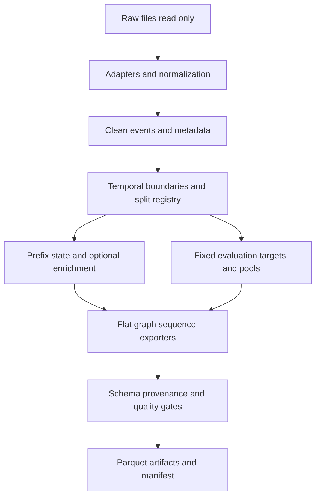

# Архитектура генератора данных

Версия: 1.0
Статус: approved
Дата последнего обновления: 2026-10-20

Нормативный контракт: [point_in_time_policy.md](point_in_time_policy.md), далее PIT.
Исходные наблюдения: [raw_data_structure.md](raw_data_structure.md).
Параметры: [configuration.md](configuration.md). Генератор создает совместимые
артефакты для Baseline, Adv1 AutoML, Adv2 GNN, Adv3 Seq и Adv4 Fusion; каждый
датасет обрабатывается отдельно. Python 3.10+, Polars lazy, Parquet, pathlib.Path.

## 1. Порядок и интерфейсы модулей



Splits определяются на реальных очищенных событиях ДО personas/negatives.
Реализация модулей сохраняет порядок итераций из implementation_plan.md;
это не означает enrichment до определения времени в исполняемом DAG.

Базовый adapter: `load_raw() -> pl.LazyFrame`, `normalize() -> pl.DataFrame`,
`validate() -> list[str]`. Для больших данных load_raw lazy, предикаты и projection
применяются до collect; normalize материализует только ограниченную partition,
не весь Taobao. Orchestrator обрабатывает partitions и sink_parquet; публичный
контракт normalize не разрешает бесконтрольный full collect. Metadata читается
отдельными lazy scans. Ошибки ключей/парсинга/enum fatal с source_row_id;
допустимые удаления и unknown — в quality counters.

## 2. Адаптеры и очистка

Идентификаторы не переиспользуются между датасетами. Source row назначается до
фильтра; file_code для core событий: RetailRocket events=1; Taobao UserBehavior=1;
Yoochoose clicks=1, buys=2, official test=3; MovieLens rating=1. Прочие файлы —
metadata, не core events. Полный event_id по PIT §9.8. Порядок файлов фиксирован
конфигом, не зависит от directory listing. Core всегда is_synthetic=false.

### 2.1. RetailRocket

- events.csv: timestamp:int64 milliseconds, visitorid:int64, event:string,
  itemid:int64, transactionid:string nullable. Dedup по всем исходным полям,
  сохранить меньший source_row_id; число удалений измерить (исторически 460).
- timestamp=floor(ms/1000), timestamp_ms=исходник; view→0, addtocart→1,
  transaction→2. Ключи не null. Границы событий вне 2015 года — fatal validation
  с отчетом, не молчаливая подгонка под ожидаемые counts.
- Properties parts: `(timestamp_ms,itemid,property,value)`; объединить, удалить
  только точные дубли. Для каждого `(item,property)` сохранить все snapshots.
  Конфликт разных value при одном исходном времени — fatal, не выбирать по
  порядку файлов. Если разные мс попали в одну секунду, оба недоступны до следующей
  секунды; затем выбрать самый поздний исходный мс (детерминированный batch).
- Для запроса T backward as-of по `(item,property)`, metadata timestamp<T;
  в Polars `allow_exact_matches=False`. Только после этого join category tree.
  Проверять, что число query-строк не изменилось.
- category_tree: 25 корней и глубина 5 — наблюдения, не hardcoded schema. Проверить
  уникальность categoryid, отсутствие циклов и missing parents. Неразрешенный
  parent становится orphan-root с audit flag; неизвестная категория item
  сохраняет raw category_id, derived root/depth unknown. 24 отсутствующих в дереве
  category IDs не удаляют реальные events. full_path из raw IDs, без выдуманных имен.
- `available` 0/1 → bool. Остальные свойства — token lists, префикс n не доказывает
  цену. transactionid не feature. Co-purchase только по завершенной транзакции.

### 2.2. Taobao

Без заголовка: user_id:int64, item_id:int64, category_id:int64, behavior:string,
timestamp:int64 seconds. scan_csv назначает имена и типы явно. Сначала окно
UTC `[2017-11-24,2017-12-04)`, затем dedup полного исходного пятиколоночного ряда;
исторический счетчик 49 относится к ключу без category и не задает число удалений.
Два разных category для одной пары событие/время не склеивать без отчета.
Неизвестный behavior fatal; pv→0, cart/fav→1, buy→2.

category static_assumed допустим только после проверки item→category на постоянство;
глобальное majority по всей выгрузке запрещено. Несовпадение вызывает явную ошибку
static режима и предложение observed_asof. В observed режиме последняя категория
из событий timestamp<T; conflicting same-second category → unknown с audit flag.
Полный scan2026-10-19 обнаружил изменяемый mapping: default теперь observed_asof.
Конфликтная секунда дает category_id=-1, category_conflict=true. Повторные одинаковые
состояния сжимаются в change points; tombstone сбрасывает прошлую graph relation.
Дерево/brand/цена в источнике отсутствуют. Синтетическая иерархия выключена primary.

### 2.3. Yoochoose

clicks/test: session_id:int64, timestamp:string ISO-8601 UTC, item_id:int64,
category:string. buys: session_id:int64, timestamp:string, item_id:int64,
price:int64, quantity:int64. Parsing сохраняет timestamp_ms и seconds. Невалидный
ISO/ID fatal. quantity<=0 не образует purchase event, счетчик отдельно (исторически
610030 строк quantity=0). Отрицательная price — invalid, price=0 допустимо.

clicks dedup по `(session_id,original_timestamp,item_id,category)`; строки с тем же
трехколоночным ключом, но разным context — не автоматически дубли: сохранить
контексты в audit, для core одна click-запись с минимальным source ID и context
unknown. Исторические 69 — число лишних трехключевых записей, не гарантия exact duplicates.
Buys дедуплицируются только при полном совпадении полей, повторы реальных покупок
без transaction ID не агрегируются самовольно. Покупки с quantity>0→label2,
click→label1; user_type=session. price/quantity доступны лишь для прошлых purchase
aggregates, не как static metadata для предсказания этой покупки.

Category parsing по PIT §6.3: raw='S' → special, '0'→unknown, 1..12→category,
прочие положительные числа→brand. Неизвестный токен→unknown с счетчиком.
Поля is_special_offer/is_missing_category принадлежат прошлому context, не target
feature. Item category/brand рассчитывать по прошлым счетчикам, ties меньший raw ID.

Official test по умолчанию не включен. Если включен, он физически отделен,
не попадает в fit, train enrichment или основной graph. Target window совпадает
с поздним primary test, ранние строки служат только prefix этой session.
Проверка session intersection official∩(clicks∪buys)=∅ обязательна.

### 2.4. MovieLens 20M

Локальные файлы имеют singular names и timestamp datetime string; не подменять
официальными plural names или unix parser. rating.csv userId/movieId int64,
rating float64, timestamp string `YYYY-MM-DD HH:MM:SS`, UTC assumption.
Допустимые ratings 0.5..5 шаг0.5; >=4→2, {3,3.5}→1, <=2.5→0. Exact duplicate
удалять с минимальным source ID; разные ratings одной пары в разное время
сохранять как реальные события, повторные targets для unseen_only не eligible.

movie.csv: title/genres static_assumed; `genres.split('|')`, `(no genres listed)`
→ unknown genre. release_year только regex из title, ошибки→null. link.csv:
imdbId/tmdbId nullable, внешние IDs не числовая мера релевантности. tag.csv
имеет собственные UTC timestamps, только as-of<T. Genome scores/tag vocabulary
не используются strict primary; разрешена diagnostic static_assumed ablation,
обоснование/риск в PIT §6.4. user demographics отсутствуют.

## 3. Splits, targets и replay

RetailRocket/MovieLens: после чистки реальных событий отсортировать timestamps.
`T1=sorted_ts[floor(0.8*(n-1))]`, `T2=sorted_ts[floor(0.9*(n-1))]` (lower quantile).
Группы равных timestamps не разделять; train<T1, valid `[T1,T2)`, test>=T2.
Если T1>=T2 или split пуст — fatal. Квантили — только решение об экзаменационном
периоде, не feature. Resolved UTC границы сохранять, не пересчитывать для моделей.

Taobao: UTC train `[2017-11-24,2017-12-02)`, valid `[12-02,12-03)`,
test `[12-03,12-04)`. Yoochoose: train до 2014-09-01, valid до 2014-09-15,
test до 2014-10-01. Нет фильтра пользователей по будущей активности/длине сессии.

Primary predicates: RetailRocket event_type==transaction; Taobao ==buy;
Yoochoose ==click; MovieLens original rating>=4 (event_type=rating_<value>).
Одна общая registry выбирает последний eligible primary event на user/split
valid/test. Fallback: addtocart/cart/last_click/rating3–3.5 только отдельным mode.
Для Yoochoose last_click совпадает с primary strategy и не восстанавливает
пользователей, у которых вообще нет кликов в этом сплите.

Основной протокол replay: веса fitted только train, frozen valid/test; история,
агрегаты и граф могут видеть реально произошедшие ранние valid/test events `<T`.
Все модели получают одинаковый доступный поток; oracle annotations в replay нет.

## 4. Personas и train negatives

Personas выключены primary. Для ablation daily snapshot s обучается на `<s`
и применяется только для T>s. В каждой обучающей временной partition используются
артефакты из предыдущего префикса, а не один cluster fit по всему train.
User/item vector: ограниченный hash-space 256 для category frequencies и counts
за 1/7/30 дней; L1 normalize, стандартизация fitted тем же префиксом.
MiniBatchKMeans K=32, batch_size=4096, seed42; если объектов меньше K, K_eff=min(K,n).
При n=0 → cold_start. Все thresholds/centroids/assignment имеют cutoff.

Уровень: расстояние до nearest centroid, per-cluster q50/q85 из fit prefix:
<=q50 core, (q50,q85] middle, >q85 boundary. При <5 prior interactions принудительно
boundary; без истории cold_start. Синтетические age/city не выдаются за реальные
факты и не входят primary. Optional mixing: core0, middle0.25, boundary0.5 вероятности
заимствования одного из двух следующих centroids; RNG по entity/snapshot/seed.
GMM — альтернативная ablation с собственным config hash, не скрытая замена.

Negatives: для каждого eligible train positive 4 ненаблюдаемых candidate items;
proportions global/cluster_mixed/hard_boundary = .5/.3/.2, стратегия выбирается
seeded categorical draw для каждого слота. Global uniform; cluster_mixed —
2-й/3-й nearest prefix cluster; hard — собственный кластер/known category.
Если источника нет, fallback uniform. Без personas hard использует только category.
Исключить context item и предшествующие/одновременные user interactions согласно
PIT §4.8; уникальность на context item, catalog только prefix. Недостаток candidates
— skip с счетчиком. Все train weights=1, никаких future-dependent drop/downweight.
Ненаблюдаемость — слабая отрицательная метка, не доказанный impression.

future_positive_conflict и first_future_ts рассчитываются ПОСЛЕ фиксации negatives
оценщиком, не подаются sampler/features/weights. Synthetic categories, label flips
и personas не меняют real ground truth, каждый вид enrichment отдельной ablation.

## 5. Evaluation sampler

Алгоритм — PIT §8: common target registry, E из repeat-policy + target + обязательные
positives eval-сплита, C(T), 99 без возвращения с seeded strategy. Нет циклов
повторного семплирования с неизменным seed. Last_event_only используется всеми
пятью моделями и sequence exporter, а не только Seq. Cold groups/empty history
сохраняются, кроме явно неeligible unseen target или нехватки 99 negatives.

Пулы valid/test/official/fallback сохраняются отдельно, long format §9.7.
Manifest содержит primary predicate, repeat policy, размеры E и C, число dropped
пользователей/targets, seed, oracle horizon, boundary и hash. Будущая информация
из E/coverage недоступна моделям. Флаг exclude_future_positives не отключает
обязательные positives eval-сплита. У MovieLens E включает всю историю оценок
как evaluator oracle, в inputs только прошлое.

## 6. Экспортеры и масштабирование

Flat exporter выдает queries `(user_id,candidate_item_id,target_cutoff_ts)` и
разрешенную PIT metadata; не считает ручные агрегаты за модель. Feature engineering
принадлежит models/baseline, DFS — adv1. Labels сохраняются отдельно от feature
whitelist; source IDs/candidate_type/exclusion fields не признаки.

Graph exporter: sparse edge list с temporal provenance. Daily snapshots могут
храниться base+delta, без полного дублирования каждого дня. Neighbor fanout [15,10],
2 слоя; синтетические user-user/item-item максимум 10 соседей на узел через bounded
cluster reservoirs, не clique. Co-purchase отключен primary; ablation максимум
20 партнеров на item на завершенную корзину, pair timestamp=max времен участников,
и только после закрытия корзины. Нет всех user×item/category×category пар.

Sequence exporter: train leave_one_out (по каждому eligible train target);
valid/test last_event_only из common registry. История включает прежние реальные
события, не synthetic negatives; cutoff по всей истории независимо от split.
Retain last50 через per-user deque, atomic timestamp groups. Empty history keep;
max=null, cold token создается в model collator. Padding не записывается как событие.
History category as-of history time, multi-genres через отдельный metadata lookup;
целевой event никогда не токен.

Taobao lazy projection/filter → disk partitions → external temporal sort →
streamed state → chunked Parquet. Память O(active-state + batch*L + sampled-neighbors),
embedding table O((U+I)*d), disk O(N + N_targets*L + edges), L<=50 фиксирован.
Нельзя collect full dataset ради Python loop или хранить N×N similarity. KMeans
mini-batch, graph sparse; budgets chunk_rows=1M/max candidates100/fanout фиксированы.
Перед полным run — probe ресурсов и sample profile, измерить peak RSS/time/disk.

## 7. Схемы: точная копия PIT §9.1–9.7

Следующие определения совпадают по именам, порядку и физическим типам с PIT.
Изменять можно только синхронно с повышением schema_version. Дополнительные
реестры/IDs/manifests/categories — PIT §9.8.

### 9.1. Events table

```text
event_id: int64
user_id: int64
item_id: int64
timestamp: int64
timestamp_ms: int64 nullable
label: int8
event_type: string
dataset_source: string
user_type: string
is_synthetic: bool
source_row_id: int64
user_event_seq: int64
split: string
target_cutoff_ts: int64
```

Ключ `event_id`; все поля, кроме явно nullable, обязательны. В core только реальные
события (`is_synthetic=false`). `label` ∈ {0,1,2}, `user_type` ∈ {persistent,session},
`split` ∈ {train,valid,test}; в отдельном official-файле split=test, режим задан manifest.
`target_cutoff_ts=timestamp`. Все int64 времени — UTC Unix seconds, кроме timestamp_ms.
Если есть timestamp_ms, `timestamp=floor(timestamp_ms/1000)`; он служит аудиту,
не разрешает использовать события внутри той же секунды.

### 9.2. Item metadata table

```text
item_id: int64
dataset_source: string
field_name: string
field_value: string
valid_from: int64
valid_to: int64 nullable
availability_class: string
source: string
snapshot_timestamp: int64 nullable
```

Ключ `(dataset_source,item_id,field_name,valid_from)`. Long format.
`field_value` — канонический JSON в UTF-8 String (скаляр/список), физического union
в Parquet нет. Пропущенное значение — отсутствие записи; JSON null запрещен.
Логические типы полей задает реестр ниже. `availability_class` ∈
{static_assumed,observed_snapshot,derived_pit}; `source` ∈ {raw,synthetic,derived}.
Для static `valid_from=-9223372036854775808`, snapshot_timestamp=null.
Для observed `valid_from=snapshot_timestamp`; для derived — время выпуска
префиксного артефакта. `valid_to` — только audit, его нельзя подавать модели или
использовать для выбора записи с учетом будущего. As-of выбирает последнюю
из доступных записей с valid_from < T независимо от будущего valid_to.
`observed_asof` в конфиге означает способ join для observed_snapshot.

### 9.3. User metadata table

```text
user_id: int64
dataset_source: string
field_name: string
field_value: string
valid_from: int64
valid_to: int64 nullable
availability_class: string
feature_source: string
fit_cutoff_ts: int64 nullable
cluster_level: string nullable
seed: int64 nullable
```

Ключ `(dataset_source,user_id,field_name,valid_from)`. Кодирование field_value
и доступность как §9.2. `feature_source` ∈ {real,synthetic,derived};
`cluster_level` ∈ {core,middle,boundary,cold_start} или null для иных полей.
Для fitted fields обязательны fit_cutoff_ts и seed, с
`fit_data_max_ts < fit_cutoff_ts <= valid_from < T`. Cutoff — исключающая верхняя
граница, поэтому равенство fit_cutoff_ts и valid_from безопасно.

### 9.4. Graph edges table

```text
edge_id: int64
src_type: string
src_id: int64
dst_type: string
dst_id: int64
edge_type: string
timestamp: int64
valid_from: int64
valid_to: int64 nullable
weight: float64 nullable
dataset_source: string
split_snapshot_id: string
source: string
```

Ключ `(split_snapshot_id,edge_id)`. `src_type/dst_type` ∈ {User,Item,Category,Brand};
User означает Session для Yoochoose. `source` ∈ {real,synthetic}. Для реального
interaction timestamp=valid_from=время события. Статические ребра используют sentinel
§9.2. Для derived edges время равно времени доступности артефакта; fit cutoff
сохраняется в manifest. Изменяемая item-category связь выбирается as-of, а не
накапливается с будущими категориями. Никаких плотных adjacency matrices.

### 9.5. Sequence samples table

```text
sample_id: int64
user_id: int64
target_event_id: int64
target_item_id: int64
target_timestamp: int64
target_label: int8
cutoff_ts: int64
history_event_ids: list[int64]
history_item_ids: list[int64]
history_timestamps: list[int64]
history_labels: list[int8]
history_category_ids: list[int64]
history_time_deltas: list[int64]
max_history_timestamp: int64 nullable
dataset_source: string
split: string
```

Ключ sample_id=target_event_id. `cutoff_ts=target_timestamp`; все списки имеют
одинаковую длину ≤50, без null elements. Неизвестная категория кодируется 0 в
модельном словаре (raw categories перенумеровываются отдельно с 1).
Пустая история — шесть пустых списков и max_history_timestamp=null; ее не удаляют.
Для непустой max_history_timestamp < target_timestamp, дельты положительны.
Сам target_event_id отсутствует; прежнее событие с тем же item допустимо при
repeat-policy. Нельзя удалять прошлый item только из-за совпадения с ответом.

### 9.6. Negatives table

```text
negative_id: int64
user_id: int64
item_id: int64
context_event_id: int64
context_timestamp: int64
timestamp: int64
label: int8
negative_type: string
dataset_source: string
sampling_seed: int64
catalog_snapshot_ts: int64
future_positive_conflict: bool
conflict_first_future_ts: int64 nullable
```

Ключ negative_id; уникально `(context_event_id,item_id,negative_type)`.
`timestamp=context_timestamp`, label=0; negative_type ∈
{global,cluster_mixed,hard_boundary}. Только train. Последние два поля —
evaluator-only диагностические аннотации: хранить можно, читать моделью, feature
builder, sampler или вычислением training weights нельзя. Аннотация не меняет
состав или порядок обучающих строк. Без future conflict конфликтное время null;
иначе строго больше context_timestamp. Флаг true тогда и только тогда, когда
в наблюдаемой выгрузке есть реальное взаимодействие того же user/item после
context_timestamp; conflict_first_future_ts — минимум таких timestamps. Этот
широкий конфликт не ограничен primary-positive predicate, что фиксируется в
audit metadata. catalog_snapshot_ts < context_timestamp.

### 9.7. Evaluation candidates table

```text
eval_group_id: int64
user_id: int64
target_event_id: int64
target_timestamp: int64
ground_truth_item_id: int64
candidate_item_id: int64
candidate_label: int8
candidate_type: string
dataset_source: string
sampling_seed: int64
catalog_snapshot_ts: int64
exclusion_policy: string
```

Ключ `(eval_group_id,candidate_item_id)`; eval_group_id=target_event_id в пределах
протокола. Ровно 100 разных candidate_item_id, один candidate_label=1;
он совпадает с ground_truth_item_id и имеет candidate_type=ground_truth.
Остальные candidate_label=0, candidate_type ∈ {random,popularity,hard}.
`exclusion_policy` — строка имени repeat-policy; split, mode, primary_target,
exclusion_set_size, oracle horizon и hash пула — в отдельном group manifest,
не в model inputs. sampling_seed — детерминированный seed группы.

## 8. Каноническая файловая структура

```text
configs/                         # YAML из configuration.md, Этап 3
experiments/{model}/{dataset}/{run_id}/
  metrics.json                   # результаты эксперимента, не processed data
  predictions.parquet
  run_manifest.json
  model.pkl                      # либо нативный формат модели

data/{dataset}/
  README.md
  raw/                           # исходные файлы только читать
    .gitkeep
  processed/
    .gitkeep
    core/unified_events_train.parquet
    core/unified_events_valid.parquet
    core/unified_events_test.parquet
    core/unified_events_official_test.parquet    # optional, весь source для prefix
    metadata/items.parquet
    metadata/users.parquet
    metadata/categories.parquet
    training/negatives.parquet
    training/sequence_samples.parquet
    evaluation/valid/eval_candidates.parquet
    evaluation/valid/eval_groups.parquet
    evaluation/valid/sequence_samples.parquet
    evaluation/test/eval_candidates.parquet
    evaluation/test/eval_groups.parquet
    evaluation/test/sequence_samples.parquet
    evaluation/official_test/...               # отдельный optional protocol
    evaluation/fallback_valid/...              # отдельная optional когорта
    evaluation/fallback_test/...
    model_specific/graph/snapshot_id=.../edges.parquet
    model_specific/flat/{split}_queries.parquet
    audit/artifact_manifest.parquet
    audit/quality_gates.parquet
    audit/cleaning_counters.parquet
```

Processed данные только Parquet. run_id/config/pool hash предотвращают повторное
использование чужих artifacts. Работа с путями через `Path(project_root) / 'data' /
dataset / 'raw'`; корень вычисляется из config/script, не из произвольного cwd.
relative config paths разрешаются относительно project root. Конфиги/experiments
находятся в корне, не в data. Старые eval_pairs, user_sequences, training/sequences
и gnn_edges без snapshot не являются альтернативными контрактами.

## 9. Критерии приемки генератора

Все gates PIT §11 проходят: ноль нарушений на структурных проверках, prefix
fixtures и детерминированная выборка реальных targets. Повторный запуск с теми же
raw/config/code/environment дает одинаковые значения и registry/pool hashes.
Ошибки парсинга, конфликтующие ключи и недопустимый fit — информативные errors;
разрешенные unknown/skip — явные counters. Все joins проверяют cardinality.
Metadata artifacts имеют lineage, policy/config/raw hashes. Прогон на smoke subset
не считается полным Taobao экспериментом; full-data acceptance — отдельная итерация.

## История изменений

- 2026-10-19 — 1.0 draft: одна схема и структура, алгоритмы adapters/enrichment,
  четкие splits/targets/replay, sequence strategies, evaluator oracle, ресурсные
  ограничения и приемка; устранены К1–К10, К12–К15, В2–В8, Н1–Н4.

- 2026-10-19 — пользователь подтвердил план и переход к реализации; состояние выполнения отражено в project_status.md.

## Уточнения интерфейсов реализации (2026-10-19)

Ingestion до split использует внутреннее split=unassigned; это не экспортируемый
core артефакт. Финальный exporter обязан заменить значение на train/valid/test.
normalize материализует максимум100000 rows; для full logs — normalize_lazy/
iter_normalized. Yoochoose rolling item category/brand modes требуют состояния
между batches: iter_metadata обновляет prefix counts после всей группы равных
секунд и выдает уникальные item/field/timestamp snapshots. metadata_lazy Yoochoose
предназначен только для bounded samples; full exporter читает iter_metadata.
Нельзя выдавать сырые context rows с дублирующимися metadata keys за items table.

- 2026-10-19 — зафиксированы ingestion-only split и bounded metadata interface
  перед реализацией адаптеров, без изменения финальных схем PIT.

### Состояние обучающего sampler

SortedList хранит доступный catalog в порядке item_id и дает выборку по индексу
без пересортировки на каждом target. История user/item для full runs хранится
в SQLite с индексом, а не Python set на все100M events. Для fixtures допустима
та же реализация в памяти. Catalog обновляется после всей timestamp-группы;
same-second positives участвуют лишь в supervision exclusions. Rejection sampler
имеет конечный лимит и детерминированный scan fallback; shortfall записывается
счетчиком, не приводит к бесконечному циклу. Future annotations — отдельный проход.

### Временные индексы и режим smoke

SQLite используется только как удаляемый runtime-индекс внутри изолированного
.venv/runtime/<uuid>; это не выходной датасет. Все пользовательские выходы в
processed — Parquet. Runtime directory и spilling storage удаляются в finally,
не записываются в raw и не включаются в manifest данных.

--sample-modulus=N оставляет полную историю пользователей user_id%N=0 и явно
помечает output mode=smoke, отдельный processed/smoke/<N>/ каталог. Это проверка
работоспособности, не замена full-data эксперимента. --row-limit оставляет только
prefix исходных файлов и может не покрыть fixed split; такие данные не получают
выдуманных valid/test дат. В полном режиме сэмплирования пользователей нет.

Адаптер normalize_lazy может принимать заранее отфильтрованный поток observations;
source IDs сохраняются, user_event_seq определяется по полной оставшейся истории
каждого пользователя. Выходные схемы и strict timestamp<T неизменны.

Personas snapshot выдает assignments только сущностей с наблюдениями за последние
30 дней; lifetime counters для них остаются по всему доступному префиксу.
Неактивные сущности сохраняют последнюю известную metadata запись до нового
наблюдения, но не размножаются заново ежедневно. Это ограничивает дисковый объем
сессионного Yoochoose. Sparse row mapping использует NumPy searchsorted, расстояния
до32 centroids вычисляются batches, без плотной users×centroids таблицы целиком.
Для MovieLens genre frequencies поддерживают list category_ids с отдельным
исходным event stream для счетчиков, чтобы multigenre не удваивал counts.

### Завершенность и изолированные когорты

Генерация отмечается generation_state.parquet: running, failed, complete.
Модели читают только complete с ожидаемым config hash и точными путями из
artifact_manifest.parquet; glob старых graph parts запрещен. Повторный запуск
не использует старые parts, каждый run имеет уникальные имена delta files.
Manifest содержит raw hashes и SHA256 каждого опубликованного файла, число
строк, версии schema/policy/code/environment; profile включен в manifest.
Personas имеют отдельный fit_provenance и snapshot cutoff в manifest.

Fallback-cohort экспортируется отдельно даже при нулевом размере. Official
Yoochoose при включенном флаге имеет отдельные session events/graph/targets;
catalog_events ограничен primary source, ранние official clicks не участвуют
в общем каталоге и popularity. Только targets в primary test window.
Genome diagnostic сохраняется в отдельном config-hash каталоге, strict outputs
не перезаписываются. Пустые когорты проверяются явно до сложных joins: в Polars
2.0.0 на пустом self-semi-join обнаружен native optimizer panic.

Taobao validation проверяет required fields, IDs и behavior непосредственно
на raw scan, до дедупликации: exact duplicates не меняют ни одну такую проверку.
Для static category metadata достаточно min/max category по item на разрешенном
UTC-окне; повторная сортировка/дедупликация всех 100M событий не требуется.
Это сохраняет исходный контракт, но не строит полный hash set во время validation.
Yoochoose также проверяет исходные clicks/buys отдельными streaming reductions:
парсинг дат, required IDs, price и quantity не требуют предварительной группировки
33M clicks. Сама дедупликация выполняется при нормализации выбранного потока.

В smoke mode metadata ограничивается item IDs, реально встретившимися в
выбранных историях. Фильтр применяется до группировки properties/change points,
observed metadata из interaction sources считается на выбранной user cohort.
Внешние item properties сохраняют все доступные snapshots выбранных items.
Полный режим сохраняет весь доступный catalog. Это сокращение относится только
к smoke. User modulo фильтр применяется в raw scan до clicks GROUP BY и dedup;
source_row_id назначается до него. Plan inspect показал, что Polars2.0.0 не
проталкивает внешний фильтр через datetime parsing/union в Yoochoose автоматически.

## Full-volume Retailrocket metadata memory bound

Первый полный запуск73d3e60 остановлен на metadata: measured peak RSS
5584756736 bytes при примерно2.3GiB свободной RAM. Глобальные unique/group_by
для19M property rows заменяются одноразовым streaming spool в64 runtime
Parquet partitions по item_id modulo64. Каждая partition отдельно проходит
тот же exact dedup, conflict validation, second rounding и JSON normalization.
Все snapshots одного item остаются вместе; ни одна строка не отбрасывается
ради размера. Raw immutable, output schema/keys/value semantics прежние.
Smoke с row limit или item cohort сохраняет bounded прямой путь.

Runtime lookup индексы содержат только потребляемые fields: generator —
category_id/item_cluster; последовательная модель — category_id/brand_id/genres.
Полная опубликованная metadata таблица сохраняет все исходные properties.
Это сокращает временный SQLite IO, не изменяя признаки, sampling или output rows.

Hard-negative fallback использует обратный индекс category→items, если обычные
rejection draws не набрали кандидатов. SQL проверяет latest version строго<T;
более поздняя смена категории/unknown tombstone исключает старую membership.
Идентификаторы проходят прежние prefix catalog/history/exclusion predicates.
Порядок ascending item ID, число rejection draws и reservoir RNG сохраняются:
результат совпадает с полным catalog scan, включая редкие/пустые категории.

Для personas тот же inverse fallback ищет собственные/соседние clusters только
в одной доступной centroid space. Snapshot строго<T; inactive item membership
из предыдущего fit не переносится в новое пространство даже при совпадающем ID
кластера. Порядок и RNG сохраняются для обоих видов cluster sampling.

## Уникальность negative IDs на USB storage

2026-10-20: на ADATA USB Flash Drive E: профиль MovieLens с idle stacks дал
199 samples за10s,181 в SQLite INSERT negative_ids. По одной случайной записи
на каждый ID дублируется уже обязательная глобальная проверка unique key.
Полный generator использует PrefixState с explicit artifact_gate validation:
SQLite хранит causal history, а IDs проверяются native Parquet schema/unique
gate сразу после frozen sampling/annotation, до train queries и sequences.
Результат этого gate сохраняется отдельно и входит в финальный список gates;
проверка не исключается и не заменяется вероятностным collision detector.
Duplicate ID переводит generation_state в failed; model consumers принимают
только complete. Самостоятельный PrefixState по умолчанию сохраняет immediate
collision checking. Выбор validation backend не меняет seeds, draws, строки,
weights, timestamps либо evaluation pools.

Runtime metadata index также запоминает имена присутствующих fields во время
загрузки. Для полностью отсутствующего field возвращается прежний default без
SQL query. Это не future fill: имеющиеся поля по-прежнему разрешаются строго<T.

Runtime storage выбирается переменной окружения `PIT_RECSYS_RUNTIME_STORAGE`:
`project` (default, `.venv/runtime`) либо `system_temp`. Второй backend использует
фиксированный системный temp root, отдельный namespace по hash project path и
уникальный owned child directory. Произвольные external paths не принимаются;
resolved paths проверяются до использования, временный child удаляется после
закрытия индексов. TMP/TEMP/Polars spill settings восстанавливаются при выходе.
Native spill расположен в отдельном owned child с временем жизни процесса:
Polars кэширует его между этапами. Stage SQLite/Parquet по-прежнему удаляются
на выходе из scope; native directory удаляет finalizer при штатном завершении.
На текущем хосте system temp расположен на Samsung990 EVO NVMe с более1TB
свободного места; этот backend предназначен для всей очереди full jobs до HPO.
Raw и итоговые processed Parquet используют настроенные каталоги datasets на E:.
Выбор cache backend и system temp root фиксируются в environment metadata;
он не меняет semantic config hash, samples либо model budgets.
